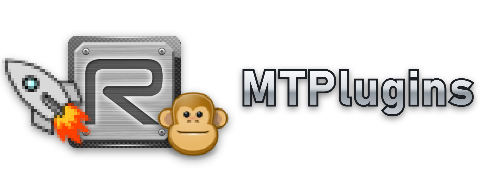

<h1 align="center"></h1>

A plugin system for the Black Ops III mod tools editors. Works with Radiant (map editor) , APE (Asset Property Editor), and the Black Ops III Mod Tools Launcher. A host DLL is loaded into the editor, adds a Plugins window (Ctrl+Shift+P) and loads the plugins found in `<game>\bin\plugins`. Nothing in the mod tools is replaced.

## Installing

Download `MTPlugins-Setup-<version>.exe` from the Releases page and run it. It finds your Black Ops III folder, lets you pick the plugins, and adds them to the mod tools without replacing anything; start Radiant or APE as usual and press Ctrl+Shift+P for the Plugins window. Uninstall it from Windows Settings > Apps.

## Plugins

| Plugin | What it does |
| ------ | ------------ |
| [Radiant+](plugins/RadiantPlus/README.md) | QOL fixes, improvements, and themes for Radiant |
| [APE+](plugins/APEPlus/README.md) | QOL fixes, improvements, and themes for APE |
| [Launcher+](plugins/LauncherPlus/README.md) | QOL fixes, improvements, and themes for the Mod Tools Launcher |
| [Team Create](plugins/TeamCreate/README.md) | Allows for multiple users to edit a map in Radiant at the same time, and to play it together with Play Test |
| [Play Test](plugins/PlayTest/README.md) | Play test your maps within Radiant, see edits live while playing, and join a Team Create host's game |

## Building

Visual Studio 2026 (v145 toolset), x64. Run `build.bat` (Release by default); output goes to `build\Release\`. `installer\build_installer.bat` builds the installer into `build\installer\` (needs Inno Setup 6); `package.bat` builds a zip into `dist\`.

## Finding more plugins

In the Plugins window, **Browse plugins** lists every plugin in the public plugin list, including other people's, and installs or updates one with a click. The Search plugins box filters both lists, and each editor asks at start when a plugin you installed has an update (Plugins > Check for updates... asks right away). Each file is checked against the SHA-256 in the list before it is installed. To add your own plugin to the list, see [MTPlugins-Index](https://github.com/Aidan601/MTPlugins-Index).

## Writing a plugin

`sdk\` holds the plugin interface (`modtools_plugin.h`, `modtools_plugin.hpp`), the `HelloPlugin` and `MapEditExample` examples and `NewPlugin.bat`. Start with `sdk\GETTING_STARTED.md`. To hook the editors' own code, read `sdk\ADVANCED.md`, `sdk\MODTOOLS_REFERENCE.md` and the full address list `sdk\MODTOOLS_ADDRESSES.md`.

## Reporting problems

In Radiant, APE or the Mod Tools Launcher, open the **Plugins** menu and pick **Report a problem...**. It collects the MTPlugins logs, settings, the plugin list, recent crash dumps and the last 15 minutes of editor actions into `MTPlugins-report-<date>.zip` on your Desktop. Nothing is uploaded. The zip can contain your Windows user name (in file paths) and map names.

Then open a [new issue](https://github.com/Aidan601/MTPlugins/issues), attach the zip and say what you were doing just before the problem. If the zip is too big to attach, upload it somewhere and link it.

If an editor stops twice in a row while starting, it offers to start without plugins next time, so you can still open it and save a report.

## Contributing

Have a QOL fix or improvement for Radiant, APE or the Mod Tools Launcher? Open a pull request on Radiant+, APE+ or Launcher+ (`plugins\RadiantPlus`, `plugins\APEPlus`, `plugins\LauncherPlus`) so everyone gets it in one place. Bug fixes for any plugin in this repo are welcome too.

Building a new feature or a bigger overhaul of how something works? Make it its own plugin with the SDK (see [Writing a plugin](#writing-a-plugin)) and add it to [MTPlugins-Index](https://github.com/Aidan601/MTPlugins-Index) so people can install it from **Browse plugins**.

## License

MTPlugins is licensed under the GNU General Public License, version 3 (`LICENSE`). MinHook (`src\third_party\minhook`) keeps its BSD 2-clause license.

Not affiliated with or endorsed by Activision or Treyarch.
